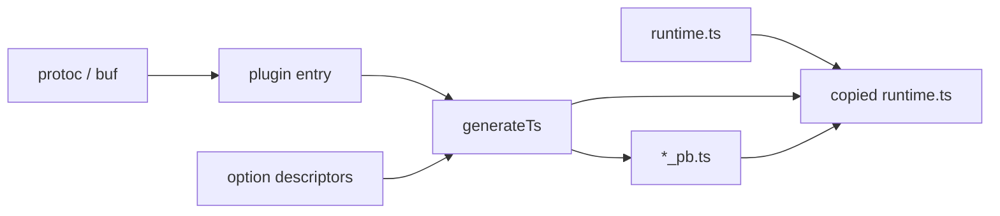

# Plugin architecture

## Topology

`protoc` (via buf) feeds a `CodeGeneratorRequest` to the Node entry. `@bufbuild/protoplugin` parses plugin options and calls `generateTs`. Generation reads option descriptors, prints one `*_pb.ts` per proto file, and copies `runtime.ts` into the output. Generated files import only that copied runtime — never the plugin, never `@bufbuild/protobuf`.

## Modules

| Module | Owns |
|---|---|
| `plugin` | Process entry, option parsing, wiring into protoplugin |
| `codegen` | What gets printed for enums, messages, services |
| `runtime` | The file copied into every output tree, and the request/path/name behavior it implements |
| `options` | Generated descriptors for the annotations the plugin reads |

`src/helpers.ts` is not its own module. It is the annotation-reading and naming seam that `codegen` uses to reach `options`. `src/runtime.macro.ts` only inlines `runtime.ts` at build time so the copy does not depend on a filesystem path at generation time.

## Dependency edges

- `plugin` → `codegen`. The entry does not print files and does not read annotations.
- `codegen` → `runtime`, `options`. It imports runtime symbols by name and reads annotations through helpers.
- `runtime` depends on neither. It is plain TypeScript copied verbatim.
- `options` is a generated leaf. Nothing in `src/` is imported from it.

## Invariants

- Generated `*_pb.ts` imports runtime symbols only. It does not import `@bufbuild/protobuf` or plugin source.
- Well-known types are not emitted as protobuf-es classes. `int64` → `BigIntString`, `bytes` → `BytesString`, `Timestamp` / `Duration` → `string`, `Empty` → `{}`.
- External messages referenced by a generated file are emitted too, so a reference always has a local file.
- Nested messages and enums are flattened to `{Parent}_{Child}` names. Proto identifiers are not valid nested TypeScript names.
- `createRequest` and `getNameParser` share one wording for missing and empty path parameters.
- The resource-name parameter regex in `generateTs.ts` and `runtime.ts` is duplicated on purpose and must stay identical. Unconfirmed: kept duplicated rather than shared because `runtime.ts` cannot import plugin source.
